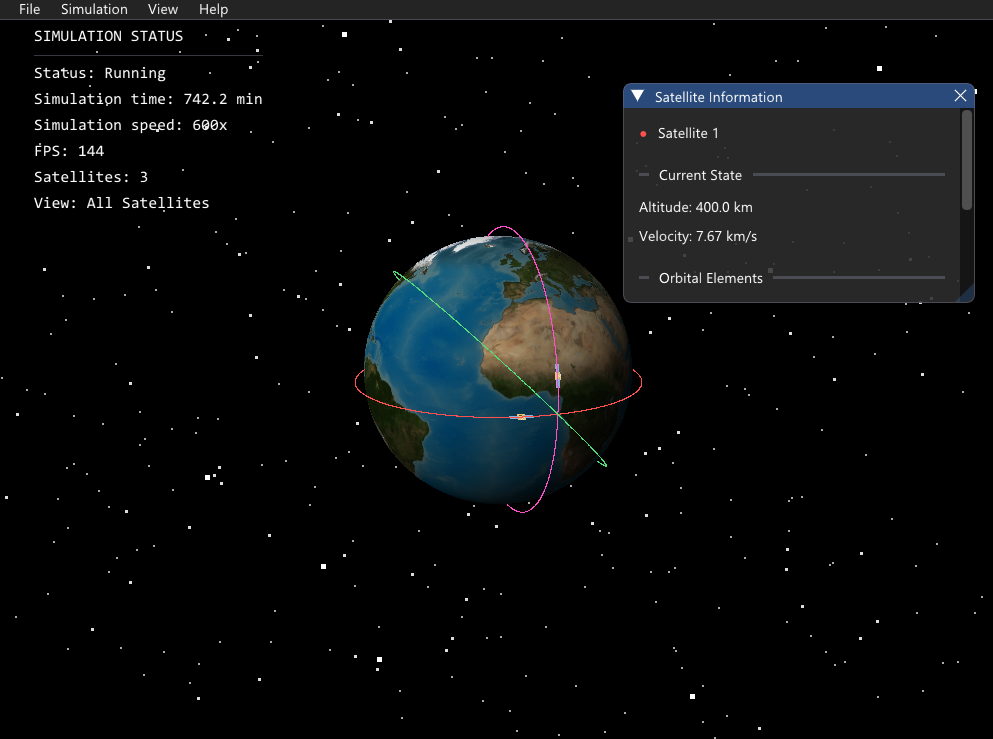

# Astravex

**Astravex** is an interactive 3D satellite orbit simulator written primarily in **C++17**, using **SDL3** for rendering and **Dear ImGui** for its GUI.

The application simulates satellite motion around Earth using Newtonian gravitational physics and numerical integration. You can create satellites, experiment with different orbital trajectories, and visualize how their orbits evolve over time.
## Preview



## Features

### Orbital Simulation
1. Simulates satellite motion under Earth's gravitational attraction.
2. Uses the Velocity Verlet numerical integration method.
3. Supports multiple satellites in the same simulation.
4. Visualises satellite trajectories with colored orbital trails.

### Interactive Controls
1. Create new simulations with custom initial conditions.
2. Add satellites to an existing simulation.
3. Predefined orbit presets.
4. Pause, resume, and restart simulations.
5. Adjust simulation speed.
6. Rotate and zoom the 3D camera.
7. Switch between Earth rendering modes.
8. Focus on individual satellites.

### Satellite Information

View orbital information, including:

1. Altitude and velocity
2. Orbital period
3. Perigee and apogee
4. Eccentricity
5. Inclination
6. Classification

### File Management
1. Create a new simulation.
2. Open previously saved simulations.
3. Save to preserve experiments.
-*I still can't figure out the Save As integration :(

## Getting Started

### Running the Windows Application

1. Download the Windows ZIP package from GitHub
2. Extract the ZIP file to a folder.
3. Open `Astravex.exe`.
4. Experiment with the simulation.


## Technologies Used

**C++17** for the application and physics implementation
**SDL3** for rendering, window management, and input handling
**Dear ImGui** for the GUI
**CMake** for the build configuration

## Building from Source

The project can be built on Windows using CMake.
SDL3 and Dear ImGui are **required dependencies**.

From the project root, configure a Release build:

```powershell
cmake -S . -B build-release -DCMAKE_BUILD_TYPE=Release
```

Build the application:

```powershell
cmake --build build-release --target SatelliteOrbit
```

The executable will be generated as `Astravex.exe` in the Release build directory.

## How the Physics Works

Astravex calculates the gravitational acceleration of a satellite using Newton's law of universal gravitation:

a = −(GM / r³) × r

The simulation updates satellite motion using the **Velocity Verlet method**. More on the physics and building process in an upcoming personalised documentation with detailed explanations and learning exercises (beware physics problems!)

